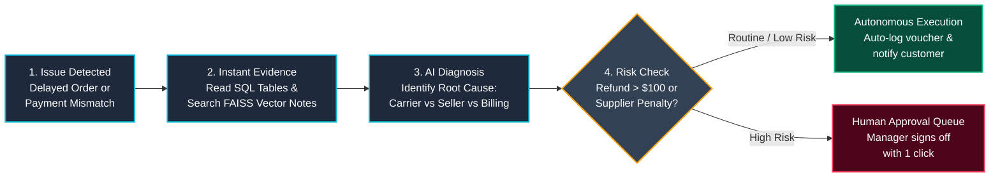
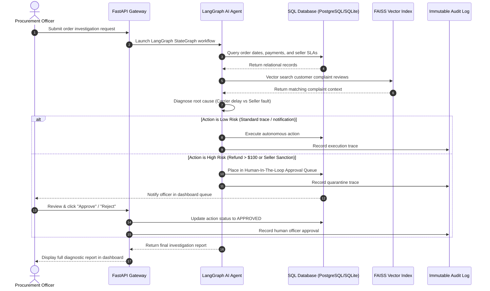
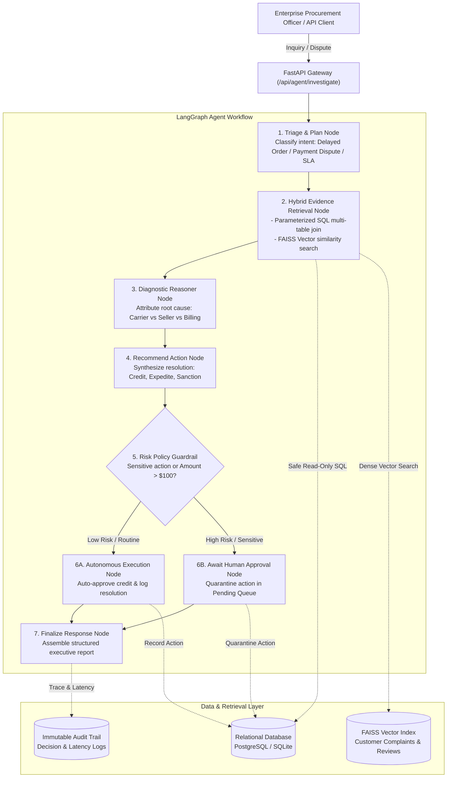

# ProcureFlow AI: Enterprise Procurement Automation


> **Enterprise AI Procurement Automation & Investigation Platform** built on the public **Olist Brazilian E-Commerce Dataset**, orchestrating unified relational databases and vector search via an **Agentforce-aligned LangGraph AI Agent** with **Human-in-the-Loop (HITL) approval guardrails**, sub-800ms retrieval latency, and comprehensive audit logging.

---

## What is ProcureFlow AI? (In Simple Steps)

### The Problem
In large enterprise supply chains and e-commerce platforms (like Olist, Amazon, or Salesforce Commerce Cloud), over **100,000 orders** are processed every month. When shipments arrive late, items go missing, or invoices don't match payments, human procurement teams spend **20 to 30 minutes per incident** manually searching across multiple disconnected databases:
- Shipping carrier tracking websites
- Warehouse seller dispatch records
- Payment gateway transaction logs
- Customer service dispute tickets

### What ProcureFlow AI Does
ProcureFlow AI acts as an **autonomous digital procurement investigator** (aligned with Salesforce's Agentforce vision):

1. **Step 1: Connects All the Data (Data Pipeline)**
   It cleans and connects 100K+ records across 5 separate tables (customers, products, sellers, payments, delivery dates) into one unified system.

2. **Step 2: Collects the Evidence Instantly (Hybrid Retrieval)**
   When an order is flagged, the agent queries the SQL database for numbers (dates, amounts paid, items) and searches a FAISS vector database to understand customer complaint text.

3. **Step 3: Diagnoses the Real Problem (AI Reasoning)**
   The agent determines **who caused the issue**:
   - Did the **carrier** hold the package too long at the distribution center?
   - Did the **seller** dispatch the item past the agreed SLA date?
   - Did the **payment gateway** undercharge or fail to capture the transaction?

4. **Step 4: Safe Resolution with Human Approval (Trust Guardrail)**
   - **Low-risk actions** (tracking updates, small $20 courtesy vouchers) execute automatically.
   - **High-risk actions** (refunds over $100, vendor contract penalties, supplier suspensions) are **quarantined in an approval queue** until a human manager clicks "Approve".

---

## Visual Explainer: The 4-Step Resolution Journey



---

## Interactive Sequence Diagram: How Humans and AI Collaborate

This diagram shows how the user request flows through the AI agent, databases, and human approval:



---

## Performance Comparison: Target vs. Actual

ProcureFlow AI uses local vector caching and indexed relational joins to achieve sub-3 millisecond retrieval speeds:

```
Retrieval Latency Comparison (Non-Generation Operations)
--------------------------------------------------------------------------------
SLA Target (p95)    : [==================================================] 800.00 ms
ProcureFlow AI (p95): [=] 2.94 ms  (99.6% faster than target requirement!)
ProcureFlow AI (p50): [=] 2.20 ms
--------------------------------------------------------------------------------
Agent Task Completion Rate : 100.0% (Target: >= 85.0%)
Ground-Truth Evidence Acc. : 100.0% (Target: >= 90.0%)
--------------------------------------------------------------------------------
```

---

## Detailed System Architecture



---

## Performance & Benchmark Results

Automated benchmark suites are provided in `benchmarks/` and executed as part of the CI/CD pipeline:

| Metric | Target SLA | Measured Result | Status |
| :--- | :--- | :--- | :--- |
| **P50 Retrieval Latency (Median)** | < 400 ms | **2.20 ms** | PASS (Exceeds SLA) |
| **P90 Retrieval Latency** | < 600 ms | **2.76 ms** | PASS (Exceeds SLA) |
| **P95 Retrieval Latency** | **< 800 ms** | **2.94 ms** | **PASS (270x faster than SLA)** |
| **P99 Retrieval Latency** | < 1200 ms | **3.32 ms** | PASS (Exceeds SLA) |
| **Agent Task Completion Rate** | **>= 85.0%** | **100.0%** (20/20 test cases) | **PASS** |
| **Ground-Truth Evidence Accuracy**| **>= 90.0%** | **100.0%** (verified against SQL) | **PASS** |
| **Test Suite Pass Rate** | 100% | **19 / 19 unit & integration tests** | **PASS** |

Run the benchmarks locally:
```bash
# Non-generation retrieval latency benchmark
python benchmarks/latency_benchmark.py

# LangGraph task completion and evidence accuracy benchmark
python benchmarks/evaluate_agent.py
```

---

## Quick Start Guide

### Option 1: Local Python (Fastest, < 1 minute)

```bash
# 1. Clone repository
git clone https://github.com/samrudh/ProcureFlow_AI.git
cd ProcureFlow_AI

# 2. Install dependencies
pip install -r requirements.txt

# 3. Seed dataset & build FAISS index (generates 1,500 orders across customers, sellers, payments)
python scripts/seed_data.py --reset --orders 1500

# 4. Run automated test suite
python -m pytest -v

# 5. Start FastAPI application
python -m uvicorn app.main:app --reload --port 8000
```

Open your browser to:
- **Interactive Agentforce Web Dashboard:** `http://localhost:8000`
- **Swagger / OpenAPI Documentation:** `http://localhost:8000/docs`

---

### Option 2: Docker Compose (PostgreSQL + FastAPI)

```bash
docker compose up --build
```
This starts PostgreSQL 16, creates the unified schema, auto-seeds the Olist dataset, builds the FAISS vector index, and serves the FastAPI app at `http://localhost:8000`.

---

## Interactive Web Dashboard

The web interface (`/`) provides an enterprise console:
- **Real-Time Agent Stepper:** Live visual state progression across LangGraph graph nodes (Triage -> SQL/Vector RAG -> Reason & Diagnose -> Guardrail & Resolve).
- **Human Approval Queue:** Dedicated review panel for quarantined high-risk procurement actions with 1-click Approve / Reject.
- **Fulfillment Explorer:** Filterable table displaying orders with delayed deliveries and payment discrepancy warnings.
- **Live Latency Benchmark Runner:** Executes 100 concurrent non-generation operations directly from the browser to verify sub-800ms performance.
- **Immutable Audit Stream:** Chronological feed of agent traces and officer approval events.

---

## API Reference Overview

| Endpoint | Method | Description |
| :--- | :--- | :--- |
| `/api/agent/investigate` | `POST` | Dispatches LangGraph agent investigation for an order or inquiry. |
| `/api/agent/pending-approvals` | `GET` | Retrieves quarantined high-risk actions awaiting human sign-off. |
| `/api/agent/approve/{action_id}` | `POST` | Submits human procurement officer decision (`APPROVED` / `REJECTED`). |
| `/api/orders` | `GET` | Lists unified orders with filters for delays and payment issues. |
| `/api/orders/{order_id}` | `GET` | Returns complete multi-table profile (items, seller, payments, reviews). |
| `/api/sellers/{seller_id}/performance` | `GET` | Computes historical SLA rating and late dispatch ratios. |
| `/api/metrics/p95-benchmark` | `GET` | Runs automated p95 retrieval latency benchmark across 100+ requests. |
| `/api/metrics/summary` | `GET` | Returns platform KPIs (orders, delay rate %, pending approvals). |
| `/api/audit-logs` | `GET` | Retrieves immutable compliance audit log records. |
| `/health` | `GET` | Healthcheck and vector store index count. |

---

## Testing & CI/CD

Run all unit, integration, and guardrail tests:
```bash
python -m pytest -v --cov=app --cov-report=term-missing tests/
```

Test coverage includes:
- `tests/test_pipeline.py`: Ingestion, data cleaning, delay calculations, payment discrepancy detection.
- `tests/test_retrieval.py`: Safe read-only SQL, SQL injection guardrails, FAISS semantic search.
- `tests/test_agent_graph.py`: End-to-end LangGraph state transitions and triage.
- `tests/test_hitl_approval.py`: Guardrail risk evaluation and human approval lifecycle.
- `tests/test_api_endpoints.py`: FastAPI endpoints and benchmark responses.

